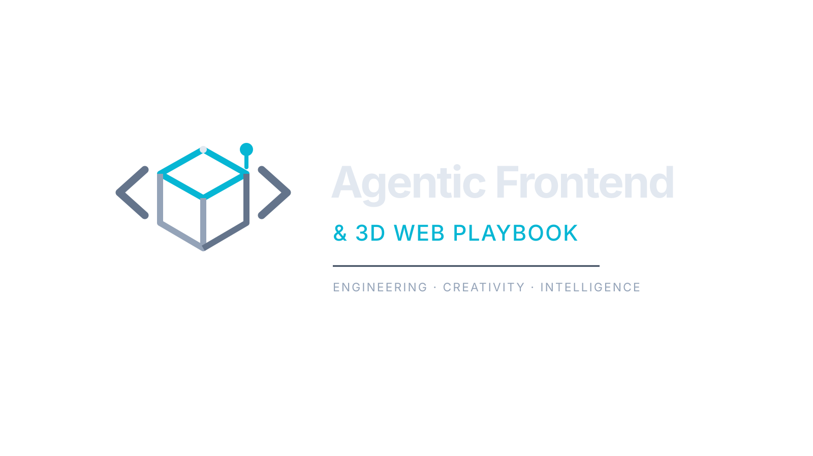

# Agentic Frontend & 3D Web Playbook

<p align="center">
  
</p>

<h3 align="center">An open-source engineering playbook for AI coding agents building modern frontend applications, immersive 3D websites, and interactive digital experiences.</h3>

<p align="center">
  <a href="#overview">Overview</a> ·
  <a href="#documentation">Documentation</a> ·
  <a href="#ai-agent-skills">AI Agent Skills</a> ·
  <a href="#examples">Examples</a> ·
  <a href="#getting-started">Getting Started</a> ·
  <a href="#contributing">Contributing</a>
</p>

<p align="center">
  
  
  
  
</p>

---

## Overview

**Agentic Frontend & 3D Web Playbook** is an open-source knowledge base and engineering resource designed to help AI coding agents and developers build high-quality frontend applications and immersive web experiences.

It brings together practical engineering principles, frontend architecture guidance, 3D web development knowledge, animation techniques, design system practices, reusable AI agent skills, implementation workflows, and complete project blueprints.

The repository is intended to work as a structured reference for AI-assisted development rather than a collection of disconnected tutorials.

Whether you are building a SaaS dashboard, a premium landing page, a creative portfolio, a 3D product showcase, or an interactive WebGL experience, this playbook provides guidance for planning, implementing, reviewing, and optimizing the result.

## Why This Project Exists

AI coding agents can generate frontend code quickly, but generating code is not the same as engineering a good product.

Common challenges include:

- Inconsistent visual design and poor layout decisions.
- Weak component architecture and unnecessary complexity.
- Incorrect or inefficient use of frontend libraries.
- Poor mobile and responsive experiences.
- Unoptimized 3D scenes and excessive GPU usage.
- Animation that feels disconnected from the interface.
- Inaccessible interactions and missing interface states.
- Inadequate testing and visual quality assurance.
- AI agents modifying existing projects without understanding their architecture.

This project addresses these challenges through reusable instructions, practical documentation, agent skills, and structured engineering workflows.

### Our Mission

Help AI coding agents produce frontend experiences that are not only functional, but also visually refined, accessible, responsive, maintainable, and performant.

## Who Is This For?

- **AI coding agent users:** Developers working with coding agents to build frontend applications.
- **Frontend developers:** Engineers looking for practical implementation and architecture references.
- **Creative developers:** Developers building interactive websites, WebGL experiences, and 3D interfaces.
- **Design engineers:** People working between visual design and frontend implementation.
- **Open-source contributors:** Developers interested in improving AI-assisted frontend engineering practices.

## What Can You Build With It?

| Project type | How this playbook helps |
|---|---|
| SaaS applications | Architecture, components, design systems, responsive interfaces |
| Premium landing pages | Visual direction, layouts, typography, animation and conversion |
| 3D portfolios | Three.js, React Three Fiber, scene design and performance |
| Product showcases | 3D product viewers, lighting, materials and interactions |
| Creative websites | Scroll experiences, shaders, motion and WebGL |
| Interactive applications | State management, component design and accessibility |

---

## Documentation

The documentation is organized into focused sections so developers and AI agents can find the right engineering guidance.

### 1. Fundamentals

Core principles for building reliable, maintainable frontend applications.

| Document | Description |
|---|---|
| [Design Principles](fundamentals/design-principles.md) | Visual hierarchy, usability, consistency, accessibility and design quality |
| [Frontend Architecture](fundamentals/frontend-architecture.md) | Application structure, components, state, routing, data flow and maintainability |
| [Responsive Design](fundamentals/responsive-design.md) | Responsive layouts, breakpoints, mobile-first implementation and adaptive interfaces |

### 2. 3D Web Development

Guidance for building interactive 3D websites and browser-based graphics.

| Document | Description |
|---|---|
| [Three.js](3d-web/threejs.md) | 3D scenes, cameras, geometry, materials, lights and rendering |
| [React Three Fiber](3d-web/react-three-fiber.md) | Declarative 3D development with React Three Fiber and Drei |
| [Shaders](3d-web/shaders.md) | GLSL, shader fundamentals, visual effects and GPU programming |
| [3D Optimization](3d-web/optimization.md) | Rendering performance, draw calls, textures, geometry and mobile optimization |

### 3. Animation & Interaction

Practical guidance for creating meaningful motion and interactive experiences.

| Document | Description |
|---|---|
| [GSAP](animation/gsap.md) | Timelines, tweens, ScrollTrigger, stagger effects and advanced animation |
| [Motion](animation/motion.md) | React animation, gestures, transitions, layout animation and orchestration |
| [Scroll Experiences](animation/scroll-experiences.md) | Scroll-triggered animation, parallax, pinned sections and 3D scroll experiences |

### 4. Design Systems

Build consistent visual systems and reusable interface components.

| Document | Description |
|---|---|
| [Colors](design-systems/colors.md) | Color theory, palettes, semantic tokens, gradients and dark mode |
| [Typography](design-systems/typography.md) | Type scales, font pairing, responsive typography and multilingual text |
| [Components](design-systems/components.md) | Component architecture, variants, states, composition and accessibility |

### 5. Agentic Development Workflows

Structured workflows that help AI coding agents work systematically.

| Document | Description |
|---|---|
| [Planning](agent-workflows/planning.md) | Requirements, project inspection, architecture, implementation plans and acceptance criteria |
| [Implementation](agent-workflows/implementation.md) | Step-by-step frontend implementation and engineering practices |
| [Visual Review](agent-workflows/visual-review.md) | Evidence-based visual inspection, responsive QA and design correction |
| [Optimization](agent-workflows/optimization.md) | Performance profiling, Core Web Vitals, frontend and 3D optimization |

### 6. Resources

Curated external resources to support frontend and creative development.

| Document | Description |
|---|---|
| [Libraries & Tools](resources/libraries.md) | Frontend frameworks, UI libraries, 3D tools, animation libraries and development utilities |
| [Design Inspiration](resources/inspiration.md) | Website galleries, design references, creative studios, 3D showcases and visual inspiration |

---

## AI Agent Skills

This repository includes reusable AI agent skills that provide focused instructions for specific frontend engineering tasks.

Skills are located in the `skills/` directory.

| Skill | Purpose |
|---|---|
| [3D Scene Builder](skills/3d-scene-builder/SKILL.md) | Helps agents plan, build, optimize and validate interactive 3D scenes |
| [Premium Landing Page](skills/premium-landing-page/SKILL.md) | Guides agents through premium landing page design and implementation |
| [Frontend Visual Audit](skills/frontend-visual-audit/SKILL.md) | Helps agents inspect frontend interfaces and identify visual and usability issues |

### How to Use the Skills

1. Choose the skill relevant to your development task.
2. Read its `SKILL.md` instructions.
3. Provide the skill to your AI coding agent using the agent's supported skill or instruction-loading mechanism.
4. Give the agent the project requirements and relevant constraints.
5. Ask the agent to follow the skill while planning, implementing, or reviewing the work.

Skills can be used independently or together.

For example, a developer building a 3D portfolio might use:

- `premium-landing-page` for the overall website experience.
- `3d-scene-builder` for the interactive 3D scene.
- `frontend-visual-audit` to review the final interface.

See the [Agent Skills specification](https://agentskills.io/specification) for the general skill format and conventions.

---

## Examples & Project Blueprints

The `examples/` directory contains detailed implementation blueprints for common frontend project types.

These are engineering references and project plans, not claims that fully working applications are included.

### 1. 3D Portfolio

[Explore the 3D Portfolio Blueprint](examples/3d-portfolio/README.md)

A creative portfolio concept combining:

- React and Next.js.
- Three.js and React Three Fiber.
- Drei for 3D helpers.
- GSAP and Motion.
- Interactive 3D scenes.
- Responsive layouts and performance optimization.

### 2. SaaS Landing Page

[Explore the SaaS Landing Page Blueprint](examples/saas-landing-page/README.md)

A structured SaaS marketing website concept covering:

- Product positioning and messaging.
- Hero and feature sections.
- Product previews and pricing.
- Design tokens and reusable components.
- Animation and responsive layouts.
- SEO, accessibility and conversion considerations.

The example uses a fictional product called Flowbase.

### 3. 3D Product Showcase

[Explore the Product Showcase Blueprint](examples/product-showcase/README.md)

A product storytelling and interactive 3D showcase concept featuring:

- Interactive product visualization.
- 3D lighting and materials.
- Product hotspots and variants.
- React Three Fiber and Drei.
- GSAP and Motion.
- Mobile fallbacks and rendering optimization.

The example uses a fictional product called AURORA ONE.

---

## Repository Structure

```text
agentic-frontend-playbook/
│
├── assets/
│   └── brand/
│       └── logo.svg
│
├── fundamentals/
│   ├── design-principles.md
│   ├── frontend-architecture.md
│   └── responsive-design.md
│
├── 3d-web/
│   ├── threejs.md
│   ├── react-three-fiber.md
│   ├── shaders.md
│   └── optimization.md
│
├── animation/
│   ├── gsap.md
│   ├── motion.md
│   └── scroll-experiences.md
│
├── design-systems/
│   ├── colors.md
│   ├── typography.md
│   └── components.md
│
├── agent-workflows/
│   ├── planning.md
│   ├── implementation.md
│   ├── visual-review.md
│   └── optimization.md
│
├── skills/
│   ├── 3d-scene-builder/
│   │   └── SKILL.md
│   ├── premium-landing-page/
│   │   └── SKILL.md
│   └── frontend-visual-audit/
│       └── SKILL.md
│
├── examples/
│   ├── 3d-portfolio/
│   │   └── README.md
│   ├── saas-landing-page/
│   │   └── README.md
│   └── product-showcase/
│       └── README.md
│
├── resources/
│   ├── libraries.md
│   └── inspiration.md
│
├── .gitattributes
├── .gitignore
├── AGENTS.md
├── CONTRIBUTING.md
├── LICENSE
└── README.md
```

---

## How to Get Started

### 1. Clone the Repository

```bash
git clone https://github.com/axomiyaindie/agentic-frontend-playbook.git

cd agentic-frontend-playbook
```

### 2. Explore the Documentation

Start with:

1. `fundamentals/` to understand the engineering principles.
2. `3d-web/` and `animation/` for immersive web development.
3. `design-systems/` for visual consistency.
4. `agent-workflows/` to understand the recommended development process.
5. `resources/` to discover relevant tools and references.

### 3. Use It With an AI Coding Agent

The repository includes an `AGENTS.md` file containing project-wide instructions for AI coding agents.

When working with an agent:

1. Open the repository as the agent's working context.
2. Ensure the agent can read `AGENTS.md`.
3. Point it to the relevant documentation and skills.
4. Explain the application you want to build.
5. Ask it to plan before making significant changes.
6. Require implementation, testing, visual review and optimization.

Example prompt:

```text
Read AGENTS.md and the relevant documentation in this repository.

I want to build a premium 3D portfolio website.

Before implementation:
1. Inspect the existing project and dependencies.
2. Review the 3D portfolio example.
3. Read the premium-landing-page and 3d-scene-builder skills.
4. Create an implementation plan.
5. Identify performance, accessibility and responsive requirements.

Then implement the project in focused steps.

Do not claim visual verification unless you have actually inspected
the rendered interface.
```

### 4. Adapt the Guidance to Your Project

The playbook is a reference, not a rigid framework.

Choose the technologies that fit your application. Follow the existing project's architecture and conventions instead of introducing unnecessary dependencies.

---

## Engineering Principles

The repository encourages the following practices:

- **Understand before implementing:** Inspect requirements, project structure and existing code first.
- **Design with intention:** Use clear visual hierarchy, consistent spacing and purposeful interactions.
- **Build maintainable architecture:** Prefer reusable components and understandable application structure.
- **Make responsive experiences:** Design for mobile, tablet and desktop.
- **Use animation purposefully:** Motion should support usability and storytelling.
- **Optimize 3D experiences:** Consider GPU performance, memory, rendering cost and mobile limitations.
- **Prioritize accessibility:** Use semantic HTML, keyboard support, visible focus and reduced-motion preferences.
- **Validate with evidence:** Do not claim that something works or looks correct without appropriate testing.
- **Avoid unnecessary complexity:** Choose libraries and abstractions based on actual requirements.

---

## Technology Ecosystem

The playbook covers and references technologies across several areas.

| Area | Technologies and tools |
|---|---|
| Frontend | React, Next.js, TypeScript |
| Styling | CSS, Tailwind CSS, modern CSS |
| 3D Web | Three.js, React Three Fiber, Drei, WebGL |
| Shaders | GLSL, ShaderMaterial |
| Animation | GSAP, Motion |
| Design Systems | Design tokens, CSS variables, component systems |
| Testing | Playwright, Vitest, accessibility tooling |
| Performance | Lighthouse, browser profiling, Core Web Vitals |
| AI Development | Agent instructions, reusable skills and structured workflows |

The inclusion of a technology in this repository does not imply that every project should use it. Select tools based on the project's requirements.

---

## Contributing

This is an open-source project, and contributions are welcome.

You can help by:

- Improving existing documentation.
- Adding practical frontend engineering guides.
- Contributing new AI agent skills.
- Adding implementation examples.
- Improving 3D web development guidance.
- Updating library and tool references.
- Fixing inaccurate information or broken links.
- Improving accessibility, performance and quality guidelines.

Before contributing, please read [CONTRIBUTING.md](CONTRIBUTING.md) and follow the repository instructions in [AGENTS.md](AGENTS.md).

### Contribution Principles

- Prefer practical, accurate and actionable guidance.
- Include examples when they improve understanding.
- Avoid unsupported claims and invented benchmarks.
- Credit original authors and respect licenses.
- Keep documentation structured and maintainable.
- Explain important technical trade-offs.

---

## Roadmap

The repository will continue evolving as frontend engineering, 3D web technologies and AI coding agents develop.

- [x] Establish repository structure.
- [x] Create core frontend engineering documentation.
- [x] Add 3D web development guides.
- [x] Add animation and interaction guides.
- [x] Create design system documentation.
- [x] Document AI agent development workflows.
- [x] Create initial reusable AI agent skills.
- [x] Add project implementation blueprints.
- [x] Add curated libraries and inspiration resources.
- [ ] Expand reusable skills for more frontend tasks.
- [ ] Add more complete implementation examples.
- [ ] Introduce automated documentation and skill validation.
- [ ] Improve continuous integration and quality checks.
- [ ] Expand testing, accessibility and visual QA resources.

The roadmap is open to community suggestions and contributions.

---

## License

This project is licensed under the **MIT License**.

You are free to use, copy, modify, merge, publish, distribute, sublicense and sell copies of this project, subject to the terms of the MIT License.

See the [LICENSE](LICENSE) file for the complete license text.

---

## Maintained By

**AxomiyaIndie**

An independent open-source initiative focused on building useful developer resources, AI-powered tools and community-driven technology projects.

- GitHub: [@axomiyaindie](https://github.com/axomiyaindie)
- Repository: [agentic-frontend-playbook](https://github.com/axomiyaindie/agentic-frontend-playbook)

Contributions, suggestions and feedback are welcome.

---

<p align="center">
  <strong>Build better interfaces. Create immersive experiences. Engineer with AI.</strong>
</p>

<p align="center">
  Made for developers and the next generation of AI coding agents.
</p>
